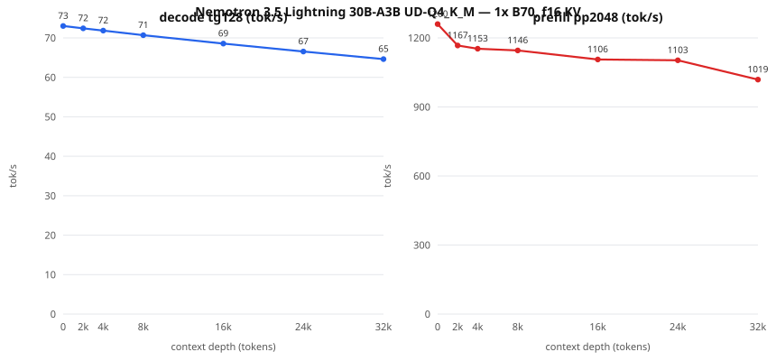

# Nemotron 3.5 Lightning 30B-A3B — candidate recipe; strict replay deferred

> **Integrity status, 2026-10-20: strict headline pending; replay deferred.**
> The historical raw suites, canaries and logs are now
> [imported and hash-bound](../../data/nemotron35-operating-points-20260822/manifest.json).
> These text-delta observations do not satisfy the native token-ID strict replay.
> The October19 attempt was interrupted, with no qualified result; the owner
> deferred another attempt. See the [incident review](../../notes/2026-10-19-nemotron-stock-headline-window.md).
> No speed headline or new LocalMaxxing submission is authorized by this import.

Status: **intake verified (direct+ordinary I/O) and baseline PASSED**
(2026-08-22) — the family runs on Intel B70 with no NVFP4 assumption.
Lane: mid MoE.

**Intake diagnostic baseline (1x B70, 8K ctx, f16 KV, target-only,
128/100 window, cache-zero verified): `72.873 tok/s` median /
`72.712` p10.** Full packet operating points still pending.

## Identity

| Field | Value |
| --- | --- |
| Model | NVIDIA Nemotron 3.5 Lightning 30B-A3B, arch `nemotron_h_moe` (hybrid Mamba-family, 53 blocks, 128 experts / 6 used, embed 2688, native ctx 1,048,576; official base `nvidia/NVIDIA-Nemotron-3.5-Lightning-30B-A3B-BF16`) |
| File | `NVIDIA-Nemotron-3.5-Lightning-30B-A3B-UD-Q4_K_M.gguf` |
| SHA-256 | `edcb5d4650796ed2fb412498de6f83b585862312c747ddb74f0ea04b22206181` |
| Source | `unsloth/NVIDIA-Nemotron-3.5-Lightning-30B-A3B-GGUF` @ `f2d3fe3694501008786e81e5f20360cbf715496a` |
| Store | `/mnt/usb-models/llm-models/nemotron-3.5-lightning-30b-a3b-udq4km/` (catalog id `nemotron-35-lightning-30b-a3b-udq4km`) |
| Base | upstream llama.cpp `9fee29e9435f865ec0b811a783a6471a136d9317`, SYCL AOT bmg-g31, IntelLLVM 2026.0.0 |
| Device | 1x Intel Arc Pro B70 (32 GiB); 2x comparison later |

Question this packet answers: does the family run on Intel B70 without
assuming NVIDIA's NVFP4 runtime works there.

## Candidate build and launch

This is a reconstruction recipe, not a clean-host certification or the exact
historical binary. Use a dedicated source/build directory and an idle B70.
The model requires about 25.3 GB of weights; the package declares at least
32 GiB host RAM. Do not use the old 12/14 GiB memory-limited campaign wrapper
on a small-RAM host or disable earlyoom to bypass its process scan.

Download the exact GGUF revision above into `$MODEL_DIR`, verify it using the
tracked manifest, and install IntelLLVM/oneAPI 2026.0.0 plus CMake and Ninja.
Build the pinned upstream commit in your own source directory:

```bash
export MODEL_DIR=/path/to/verified/model
export LLAMA_SRC=/path/to/llama.cpp-9fee29e
export BUILD_DIR="$LLAMA_SRC/build-sycl-aot-bmg-g31"
python3 scripts/verify-neural-download-model.py \
  repro/nemotron-35-lightning-30b-a3b-b70/model-manifest.json "$MODEL_DIR"
source /opt/intel/oneapi/setvars.sh --force
# LLAMA_SRC must contain upstream commit 9fee29e9435f865ec0b811a783a6471a136d9317.
test "$(git -C "$LLAMA_SRC" rev-parse HEAD)" = 9fee29e9435f865ec0b811a783a6471a136d9317
cmake -S "$LLAMA_SRC" -B "$BUILD_DIR" -G Ninja \
  -DCMAKE_BUILD_TYPE=Release -DCMAKE_CXX_COMPILER=icpx -DCMAKE_C_COMPILER=icx \
  -DGGML_SYCL=ON -DGGML_SYCL_F16=ON -DGGML_SYCL_DEVICE_ARCH=bmg_g31 \
  -DLLAMA_CURL=OFF
cmake --build "$BUILD_DIR" --target llama-server llama-bench --parallel 2
export ONEAPI_DEVICE_SELECTOR=level_zero:0
"$BUILD_DIR/bin/llama-server" \
  --model "$MODEL_DIR/NVIDIA-Nemotron-3.5-Lightning-30B-A3B-UD-Q4_K_M.gguf" \
  --alias nemotron --reasoning off --ctx-size 8192 \
  --cache-type-k f16 --cache-type-v f16 --device SYCL0 --gpu-layers 99 \
  --split-mode none --flash-attn auto --parallel 1 --cache-ram 0 \
  --ctx-checkpoints 0 --no-cache-prompt --slot-prompt-similarity 0 --fit off \
  --metrics --no-webui --host 127.0.0.1 --port 18100 \
  >nemotron-server.log 2>&1 &
echo $! >nemotron-server.pid
curl -fsS http://127.0.0.1:18100/health
```

Wait for readiness in the log; do not restart on a failed health request.
For a remote run, use an explicitly configured detached service with no restart
policy and retain its unit definition and output. The foreground shell example
above does not promise survival after disconnecting the session.

An exploratory suite uses the package's `benchmark` command. Strict promotion
instead requires the registered native-raw protocol, full token IDs and two
independent qualified attempts. The archived stock-headline runner has unsafe
historical memory/process handling and is not an approved current launch path.
After work finishes, verify that the saved PID still belongs to this launch,
then stop it gracefully with `kill -TERM "$(cat nemotron-server.pid)"`.

## Measurement coverage

| Measurement | Retained evidence / gap |
| --- | --- |
| 512-cap decode | Historical August22 text-delta A/B below; strict token-ID replay deferred |
| Standard 512-input-token prefill | Not measured; pp2048 is a separate raw-engine diagnostic |
| Context scaling | Seven measured raw-engine depths below, through 32K |
| Multi-user concurrency | Not measured; two-card layer split is not a concurrency test |
| Repeat/quality | Historical reasoning-off canaries retained; strict full-output replay pending |
| Clean-host build | Not certified; new builds must retain toolchain, binary hashes and validation |


## Context-depth sweep (llama-bench raw engine rates, fa on, 5 reps)



| Depth | decode tg128 tok/s (±σ) | prefill pp2048 tok/s (±σ) |
|---:|---:|---:|
| 0 | 73.01 (±0.01) | 1260.0 (±5.7) |
| 2,048 | 72.42 (±0.01) | 1166.9 (±3.2) |
| 4,096 | 71.85 (±0.01) | 1153.1 (±2.0) |
| 8,192 | 70.70 (±0.01) | 1145.6 (±3.8) |
| 16,384 | 68.56 (±0.02) | 1106.1 (±4.6) |
| 24,576 | 66.55 (±0.02) | 1102.6 (±1.3) |
| 32,768 | 64.62 (±0.01) | 1018.9 (±2.1) |

Raw engine rates run above server-suite medians by design (no HTTP/sampling); use the suite median as the serving expectation and this curve for the depth trend. Evidence: `nemotron-35-lightning.sweep.json` + `nemotron-35-lightning.meta.json` (model/bench shas inside).

## Historical candidate operating point: standard (8K ctx, f16 KV, target-only)

Two fresh-server runs, 12-prompt suite, 512-token responses,
conventional 99-interval median computed from raw event offsets,
`cached_tokens=0` verified per request:

- run A: **`72.169452 tok/s`**
- run B: **`72.035976 tok/s`**

Evidence: [run A](../../data/nemotron35-operating-points-20260822/nemotron-35-lightning-std.benchA.json), [run B](../../data/nemotron35-operating-points-20260822/nemotron-35-lightning-std.benchB.json), and the [hash manifest](../../data/nemotron35-operating-points-20260822/manifest.json). The metric here uses OpenAI text-delta events; native token IDs were not retained.
Only **1 of 12** complete text-output hashes matches between these two suite files.
That prevents a strict full-suite repeat claim even though the historical canaries passed.
The imported manifest records this comparison; the token-ID replay remains deferred.

Canary battery (reasoning off, temp 0, objective checks): 8x repeat hash-stability PASS, arithmetic PASS, exact copy PASS, JSON schema PASS — **pass_all=True** (`nemotron-35-lightning-std.canaries.json`).
Known behavior: with reasoning ON, 8x repeat outputs were not hash-stable (thinking-channel sampling); the retained reasoning-off canary passed its eight repeats. This is not a full-suite determinism proof. Recipe defaults to reasoning off for reproducibility-sensitive use.

## Two-card comparison (layer split, GPUs 0+1)

Same protocol, `--split-mode layer` across two B70s:
run A **`69.445407 tok/s`**, run B **`69.485984 tok/s`** (canaries 5/5).
That is ~3.7% BELOW the one-card point (72.17/72.04). **Recommendation:
one card** for single-stream serving. Evidence:
`nemotron-35-lightning-tp2.bench{A,B}.json`.
