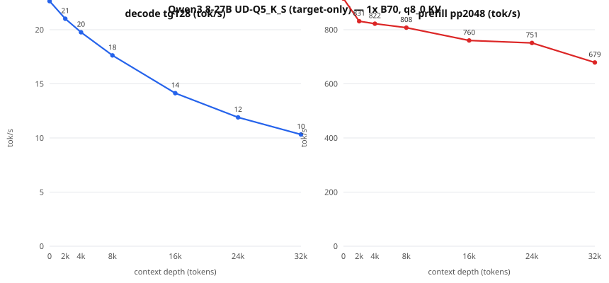

# Qwen3.8-27B 256K flagship package — vision + MTP on one B70

> **Status: candidate, not a beginner install.** Fit-off decided on 2026-08-22:
> UD-Q5_K_S ships as the flagship quant. It loads with `--ctx-size 262144`,
> 8-bit (q8_0) K/V, the vision tower and the MTP draft all on one B70. Still
> missing: a tested clean-host platform installation, broader multimodal
> quality beyond the objective smoke, and deep-context validation on the
> multi-chunk prefill path.

Qwen3.8 27B in Unsloth's UD-Q5_K_S GGUF, with image input (the `mmproj`
vision tower) and the model's MTP draft, on one Intel Arc Pro B70, for one
user. It runs stock upstream llama.cpp built for SYCL; no lab patch is needed.
The draft guesses tokens ahead and the target model checks every guess.

## Before you start

| Need | Tested with / required |
| --- | --- |
| OS | Linux. Distribution and kernel version: not recorded. No fresh-install test yet. |
| Driver stack | Intel GPU kernel driver, Level Zero runtime and Intel oneAPI at `/opt/intel/oneapi` (`setvars.sh` must exist). Versions: not recorded. |
| Runtime / build | Native build from source: stock upstream [llama.cpp](https://github.com/ggml-org/llama.cpp) at `9fee29e9435f865ec0b811a783a6471a136d9317`, SYCL AOT for `bmg_g31`, no project patches. The configure line is the one recorded in the package manifest (step 2). oneAPI compiler version: not recorded. |
| Tools | `git`, `cmake`, `ninja`, `curl`, `python3`, `huggingface-cli` and `sha256sum`. Python version: not recorded. |
| Disk | Target `Qwen3.8-27B-UD-Q5_K_S.gguf` 18,665,753,504 bytes, vision tower `mmproj-F16.gguf` 927,607,488 bytes and draft `MTP/mtp-Qwen3.8-27B-Q4_0.gguf` 1,369,590,656 bytes: about 21.0 GB. Source and build size: not recorded. |
| Host RAM | 32 GiB (package manifest). |
| GPU | One B70 with nothing else on it. Card 0 by default (`ONEAPI_DEVICE_SELECTOR=level_zero:0`); change the `0` to use another card. |
| Card memory | The fit is tight: at the full configuration the lab card still had 2.86 GiB free. The run receipts do not record the card's ECC setting. With ECC on, a B70 shows about 28 GB instead of 32 GB, and this recipe was not tested that way. See [B70 ECC and usable VRAM](https://neural.download/learn/b70-ecc-and-vram.html). |

Background reading: [KV cache precision](https://neural.download/learn/kv-cache-precision.html)
(why the cache is 8-bit here), [context length](https://neural.download/learn/context-length.html)
and [the MTP ladder](https://neural.download/learn/mtp-ladder.html).

## Quick start

Clone this repository and run every command below from its root. Replace every
`/path/to/...` with your own absolute directories.

```bash
git clone https://github.com/steveseguin/b70-optimization-lab.git
cd b70-optimization-lab

export MODEL_DIR=/path/to/qwen3.8-27b-unsloth-gguf
export LLAMA_SRC=/path/to/llama.cpp-9fee29e
export BUILD_DIR="$LLAMA_SRC/build-sycl-aot-bmg-g31"
```

### 1. Download and verify the model

```bash
huggingface-cli download unsloth/Qwen3.8-27B-GGUF \
  Qwen3.8-27B-UD-Q5_K_S.gguf mmproj-F16.gguf MTP/mtp-Qwen3.8-27B-Q4_0.gguf \
  --revision 4ca720788d1e01f1bff70c033e0d0028fd02e502 \
  --local-dir "$MODEL_DIR"

( cd "$MODEL_DIR" && sha256sum -c - ) <<'EOF'
d8d62ffcf84d42658dd6ccf9782b4d0404700af78b26d750507510c7597b5bfe  Qwen3.8-27B-UD-Q5_K_S.gguf
cbb841a9ee0636b2ec172f5bb8df2ea8dfeb01e90fe7c6126581d662a0b4e43e  mmproj-F16.gguf
50d9ce5a6da381bbcfb31061cf73df94a90e6faf8efeddee379a9cb8f1501c6e  MTP/mtp-Qwen3.8-27B-Q4_0.gguf
EOF
```

The draft lands in an `MTP` folder inside `$MODEL_DIR`, which is where the
launch command expects it. All three lines must print `OK`; the hashes are the
pinned ones in the identity table below.

The package's `preflight` command runs `scripts/verify-neural-download-model.py`
with `repro/qwen38-27b-256k-vision-mtp-b70/model-manifest.json`. That verifier
currently rejects this manifest before reading any file
(`invalid manifest: files[3].name must be a safe file name`, exit code 3,
reproduced on 2026-10-22), because the draft's name includes its `MTP/`
folder; the manifest also lists the UD-Q4_K_XL alternative, which this launch
does not use. Until the manifest is fixed, use the `sha256sum` check above. It
reads each file once through the normal page cache, so it is a weaker check
than the verifier's direct-read plus ordinary-read comparison.

### 2. Get the runtime

```bash
git clone https://github.com/ggml-org/llama.cpp.git "$LLAMA_SRC"
git -C "$LLAMA_SRC" checkout 9fee29e9435f865ec0b811a783a6471a136d9317

source /opt/intel/oneapi/setvars.sh --force
cmake -G Ninja -S "$LLAMA_SRC" -B "$BUILD_DIR" \
  -DCMAKE_BUILD_TYPE=Release -DCMAKE_CXX_COMPILER=icpx -DCMAKE_C_COMPILER=icx \
  -DGGML_SYCL=ON -DGGML_SYCL_F16=ON -DGGML_SYCL_DEVICE_ARCH=bmg_g31 \
  -DGGML_SYCL_MAX_PARALLEL_LINK_JOBS=32 -DLLAMA_CURL=OFF
cmake --build "$BUILD_DIR" --target llama-server llama-bench -j 24
```

These are the configure and build flags recorded in the package manifest
(`runtime.build`); `-j 24` is the recorded job count. Lower it on a machine with
fewer cores or less memory. Build time: not recorded.

### 3. Start the server

In terminal 1 (the server stays in the foreground):

```bash
source /opt/intel/oneapi/setvars.sh --force
export ONEAPI_DEVICE_SELECTOR=level_zero:0

"$BUILD_DIR/bin/llama-server" --model "$MODEL_DIR/Qwen3.8-27B-UD-Q5_K_S.gguf" --alias qwen38pkg \
  --mmproj "$MODEL_DIR/mmproj-F16.gguf" \
  --model-draft "$MODEL_DIR/MTP/mtp-Qwen3.8-27B-Q4_0.gguf" --device-draft SYCL0 --gpu-layers-draft 99 \
  --ctx-size 262144 --cache-type-k q8_0 --cache-type-v q8_0 --cache-type-k-draft q8_0 --cache-type-v-draft q8_0 \
  --device SYCL0 --gpu-layers 99 --flash-attn auto --parallel 1 --cache-ram 0 --ctx-checkpoints 0 \
  --fit off --metrics --no-webui --host 127.0.0.1 --port 18100
```

This is the package's `launch` command: one slot, 262,144 tokens of context,
q8_0 K/V for the target and the draft, port 18100.

### 4. Wait until it is ready

In terminal 2:

```bash
until curl -fsS http://127.0.0.1:18100/health; do sleep 10; done
```

It answers once the model, vision tower and draft are loaded. Startup time:
not recorded.

### 5. Send a first request

```bash
curl -s http://127.0.0.1:18100/v1/chat/completions -H 'Content-Type: application/json' \
  -d '{"model":"qwen38pkg","messages":[{"role":"user","content":"Say hello in five words."}],"max_tokens":64}'
```

From Python, with any OpenAI-compatible client (`pip install openai`):

```bash
python3 -c 'from openai import OpenAI; r = OpenAI(base_url="http://127.0.0.1:18100/v1", api_key="unused").chat.completions.create(model="qwen38pkg", messages=[{"role": "user", "content": "Say hello in five words."}], max_tokens=64); print(r.choices[0].message.content)'
```

Any other OpenAI-compatible app works the same way: base URL
`http://127.0.0.1:18100/v1`, model `qwen38pkg`, any API key. The server holds
one model, so the name is only a label (the launch sets it with `--alias`).
The package benchmark sends plain completions (`--api-mode completions`), not
chat requests.

The vision tower is loaded, and the lab checked it with a two-question smoke on
a small test image (see [What you get](#what-you-get)). The exact request
format of that check is not recorded in this repository, so this guide does
not show an image request.

### 6. Check status

```bash
curl -fsS http://127.0.0.1:18100/health
pgrep -ax llama-server
```

There is no separate status script. The package's benchmark command (fixed
12-prompt suite, 512-token answers, cache off) is:

```bash
python3 scripts/bench-openai-realistic-suite.py --base-url http://127.0.0.1:18100 --model qwen38pkg \
  --api-mode completions --suite repro/qwen36-27b-autoround-int4-b70/realistic-suite-v1.json \
  --max-tokens 512 --metric-tokens 100 --seed 1 \
  --request-extra-json '{"cache_prompt":false,"seed":42,"temperature":0}' --out bench.json
```

### 7. Stop

Press `Ctrl-C` once in terminal 1 and wait for the server to exit. The
package's stop command is `pkill -x llama-server`; it stops **every**
`llama-server` on the machine, so use it only if this is the only one. Then
`pgrep -x llama-server` must print nothing.

## What you get

- **Speed (MTP-assisted, full package resident):** two fresh-server runs,
  12-prompt suite, up to 512-token responses, conventional 99-interval median,
  `cached_tokens=0` verified per request: run A **`26.668277 tok/s`**, run B
  **`26.640510 tok/s`**. This is at the full 262,144-token configuration with
  the vision tower and draft loaded and 2.86 GiB of VRAM still free. The
  actual prompts were 48--78 tokens. Target-only companion: tg128
  `22.64 tok/s` at depth 0 (raw engine, q8_0 KV).
- **Quality:** canary battery (reasoning off, temp 0, objective checks): 8x
  repeat hash-stability, arithmetic, exact copy and JSON schema all pass.
  Vision smoke PASS at the full 256K configuration: a deterministic 173-byte
  test image (red field, blue corner) is answered "Red" / "Blue" exactly.
- **Context:** 262,144 tokens configured, with 8-bit (q8_0) K/V. Raw-engine
  decode falls from 22.64 tok/s at depth 0 to 10.32 tok/s at 32,768
  ([table](#context-depth-sweep-llama-bench-raw-engine-rates-fa-on-5-reps)).
  No measurement exists beyond 32,768 tokens of actual context.
- **Alternative:** UD-Q4_K_XL at the identical package configuration measured
  `27.510236` / `27.493910 tok/s` (two fresh servers, canaries 5/5), about +3%
  over the shipped Q5_K_S, for users preferring speed and headroom over the
  highest-fitting quant.
- **Limits (package manifest):** 256K KV requires q8_0 K/V on one card; f16
  KV limits context to roughly 96K at these quants. The MTP-assisted rate
  varies with content (p10 24.08 vs median 26.67). Vision was verified only by
  the two-question smoke. Above ~1024-token prompts this package relies on
  multi-chunk prefill paths that the lab's separate vLLM lane found
  corruption-prone; the llama.cpp path here passed its canaries but has not
  had equivalent deep validation at depth.
- **Not measured yet:** tested clean-host platform installation; broader
  multimodal quality beyond the objective smoke; deep-context validation
  beyond canaries on the multi-chunk prefill path; more than one user.

## If it fails

- **The package's preflight prints `invalid manifest: files[3].name must be a
  safe file name`:** this is the manifest problem described in step 1, not a
  problem with your files. Use the `sha256sum` check from step 1.
- **A `sha256sum` line prints `FAILED`:** that file is not the pinned one.
  Delete it, download it again and re-check. Never start the server on
  unverified files.
- **The server cannot allocate memory while loading:** make sure nothing else
  uses the card; this configuration left only 2.86 GiB free on the lab card.
  Keep q8_0 K/V: with f16 KV these quants fit only about 96K of context.
  UD-Q4_K_XL is the measured alternative with more headroom, and the ECC row
  under [Before you start](#before-you-start) matters here.
- Keep the server's terminal output and any benchmark JSON when you report a
  problem.

## Details

### Fit-off result (2026-08-22)

**FIT-OFF DECIDED — UD-Q5_K_S ships as the flagship quant**
(2026-08-22). It loaded and completed the diagnostic suite on one B70 at
`--ctx-size 262144` with q8_0 K/V, the vision mmproj, and the MTP draft
all resident, with **2.86 GiB VRAM still free**. Package suite rate
(**MTP-assisted**, 128/100 window, cache-zero): `27.004 tok/s` median /
`24.084` p10 (spread is content-dependent draft acceptance). UD-Q4_K_XL
becomes the documented headroom alternative. Since completed:
- **Vision smoke PASS** at the full 256K config: deterministic 173-byte
  test image (red field, blue corner), answers "Red" / "Blue" exactly
  (`qwen38-vision-smoke.json`).
- **Target-only companion**: tg128 22.64 tok/s at depth 0 (raw engine,
  q8_0 KV; see the depth sweep) vs 26.67 MTP-assisted suite median.
- **UD-Q4_K_XL alternative point** at the identical package config:
  `27.510236` / `27.493910 tok/s` (two fresh servers, canaries 5/5) —
  about +3% over the shipped Q5_K_S, for users preferring speed and
  headroom over the highest-fitting quant.

### Identity (all from `unsloth/Qwen3.8-27B-GGUF` @ `4ca720788d1e01f1bff70c033e0d0028fd02e502`)

| Component | File | Bytes | SHA-256 |
| --- | --- | ---: | --- |
| Weights candidate A | `Qwen3.8-27B-UD-Q4_K_XL.gguf` | 17,559,178,144 | `3f227079003add2511437e5b1e94812e363385225bf6a9b47b0054a72bc8b01e` |
| Weights candidate B | `Qwen3.8-27B-UD-Q5_K_S.gguf` | 18,665,753,504 | `d8d62ffcf84d42658dd6ccf9782b4d0404700af78b26d750507510c7597b5bfe` |
| Vision tower | `mmproj-F16.gguf` | 927,607,488 | `cbb841a9ee0636b2ec172f5bb8df2ea8dfeb01e90fe7c6126581d662a0b4e43e` |
| MTP draft | `MTP/mtp-Qwen3.8-27B-Q4_0.gguf` | 1,369,590,656 | `50d9ce5a6da381bbcfb31061cf73df94a90e6faf8efeddee379a9cb8f1501c6e` |

Lab storage: `/mnt/usb-models/llm-models/qwen3.8-27b-unsloth-gguf/` on the lab
host; use any local directory. Base: upstream llama.cpp `9fee29e9435f...`,
SYCL AOT bmg-g31. Device: 1x B70. The shipped package uses candidate B
(UD-Q5_K_S); candidate A (UD-Q4_K_XL) is the measured alternative.

### The fit-off (preregistered decision rule)

Architecture: 64 layers, 16 full-attention (4 KV heads x head_dim 256),
so KV at 262144 costs 16.0 GiB at f16 or 8.5 GiB at q8_0. Paper budget
(31.5 GiB card): weights + KV(q8_0) + mmproj 0.87 + draft 1.28 (+draft
KV) + compute buffers + slack. Q4_K_XL fits with ~1.4 GiB margin;
Q5_K_S has ~0.2 GiB paper margin — inside the error bar of the
compute-buffer estimate.

Rule: load each candidate with the full package (262144 ctx, q8_0 K/V,
mmproj, MTP draft) on one B70. The **highest quant that loads and
completes the diagnostic suite at 262144 without OOM ships as the
package quant**; the other is recorded as an alternative operating
point at whatever context it supports. f16-KV variants are published
only as reduced-context operating points, never as the 256K headline.

### Context-depth sweep (llama-bench raw engine rates, fa on, 5 reps)



| Depth | decode tg128 tok/s (±σ) | prefill pp2048 tok/s (±σ) |
|---:|---:|---:|
| 0 | 22.64 (±0.05) | 915.1 (±1.5) |
| 2,048 | 21.01 (±0.01) | 831.4 (±1.0) |
| 4,096 | 19.76 (±0.01) | 822.3 (±1.1) |
| 8,192 | 17.63 (±0.01) | 807.6 (±0.7) |
| 16,384 | 14.14 (±0.01) | 760.4 (±1.3) |
| 24,576 | 11.90 (±0.00) | 751.0 (±1.1) |
| 32,768 | 10.32 (±0.00) | 678.9 (±0.5) |

Raw engine rates run above server-suite medians by design (no HTTP/sampling); use the suite median as the serving expectation and this curve for the depth trend. Evidence: `qwen38-27b-q5ks-flagship.sweep.json` + `qwen38-27b-q5ks-flagship.meta.json` (model/bench shas inside).

### Published operating point: shipped package (262144 ctx, q8_0 KV, vision + MTP draft resident; MTP-assisted)

Two fresh-server runs, 12-prompt suite, up to 512-token responses
(actual prompts 48--78 tokens; one natural-EOS row per run ended early),
conventional 99-interval median computed from raw event offsets,
`cached_tokens=0` verified per request:

- run A: **`26.668277 tok/s`**
- run B: **`26.640510 tok/s`**

Evidence: `qwen38-256k-package.benchA.json` / `qwen38-256k-package.benchB.json` under
`bench-results/neural-download/operating-points-20260822/` (raw files kept on the lab
host, not in this repository).
Canary battery (reasoning off, temp 0, objective checks): 8x repeat hash-stability PASS, arithmetic PASS, exact copy PASS, JSON schema PASS — **pass_all=True** (`qwen38-256k-package.canaries.json`).
