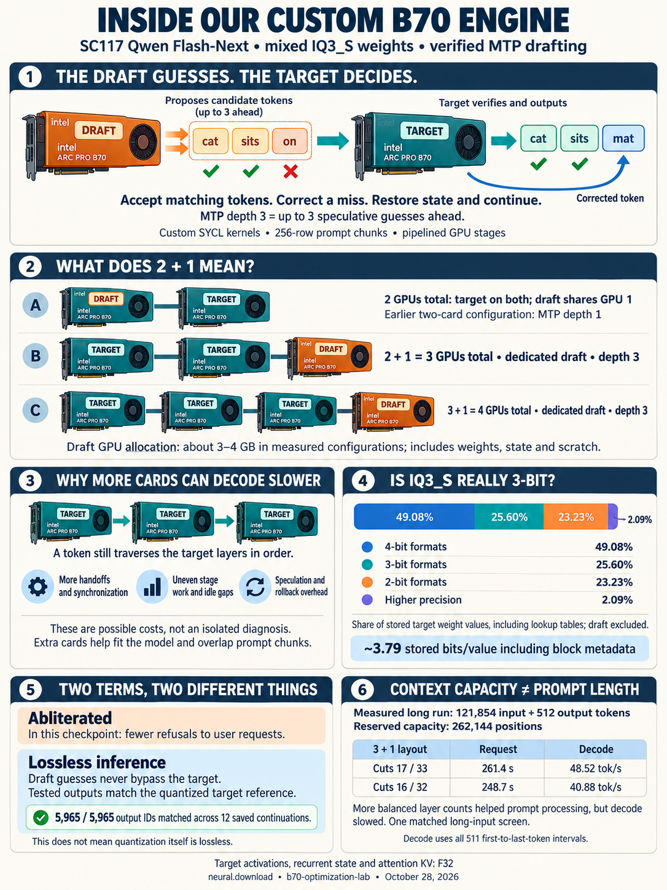

# Inside our custom B70 inference engine

[Download the shareable image](assets/engine-explainer.png).
[Current experiment results](RESULTS.md) · [Build/setup recipe](README.md).

## Target and draft roles

The target model decides which tokens are emitted. The existing MTP draft proposes
likely next tokens while target work progresses. A matching guess can continue;
a miss is corrected by the target, speculative state is restored, and generation
continues. Depth three means up to three speculative guesses ahead, not three
MTP layers, three draft models or three automatically accepted tokens.

The earlier **two-GPU configuration** splits the target over both cards and
colocates the draft with target rank 0. The retained native control uses depth
one. The newer **2+1 layout** has two target cards and a separate draft card:
three GPUs total. **3+1** has three target cards and a draft card: four total.
The latest dedicated configurations use depth three. These layouts are not
interchangeable benchmark identities.

The selected draft tensor payload is 2,698,026,496 bytes. One dedicated 128K
configuration accounted for 3,385,539,588 owned device bytes including runtime
state/scratch. Thus “about 3–4 GB” describes a measured device allocation, not
the download size or a universal context-independent limit. The original FP8
source shards total roughly 30 GB because the needed tensors share shards with
other model tensors. Existing BF16 draft arithmetic is separate from that FP8
source-weight label.

Sources: [LAN configuration notes](../../experiments/own-xpu-runtime/gsq-rco-iq3s/serving/lan/README.md),
[retained two-card control](../../experiments/own-xpu-runtime/research/pp4-review-2026-10-28/dedicated-gate/matched64k-2plus1-vs-native/control-plan.json.gz),
[deployment/model binding](../../experiments/own-xpu-runtime/engine/deployment/README.md),
and [current dedicated gate](../../experiments/own-xpu-runtime/research/pp4-review-2026-10-28/dedicated-depth2-gate/two-plus-one-aba64k-r2-evidence/index.json).

## Why additional cards do not guarantee faster decode

This is a stage pipeline: consecutive target layers live on different GPUs.
Each token must still traverse the target layers in order. It is not a split
of each individual layer's matrix multiplication across all cards. More cards
can increase handoffs and synchronization; uneven stages leave idle gaps;
speculation adds work that may be discarded on a miss. These are plausible
costs, not a measured attribution of the entire slowdown to PCIe.

Extra cards provide placement and capacity options and permit different prompt
chunks to overlap across stages. Prefill processes 256-row chunks; decode is a
stream of individual token decisions. A partition that improves one can worsen
the other. The matched long-input comparison in [RESULTS.md](RESULTS.md) shows
exactly that: equal layer counts reduced total request time but slowed decode.

The runtime is our own SYCL code, using model-specific packed-weight kernels,
explicit target/draft scheduling, authenticated state snapshots and restoration.
It is not vLLM or a llama.cpp fork. No new draft training was used.

## IQ3_S is a mixed-quantization label

These percentages count **stored target tensor values**, not tensor objects,
GPU memory allocation, active experts per token or file-byte share. They include
the large per-layer embedding (PLE) lookup table and exclude the separate draft.

| Nominal format family | Share of target values | Share of encoded payload bytes |
| --- | ---: | ---: |
| 2-bit | 23.2301% | 15.3499% |
| 3-bit | 25.6005% | 21.6180% |
| 4-bit | 49.0774% | 58.1555% |
| 5-bit | 0.2496% | 0.3622% |
| 6-bit | 0.9382% | 1.6240% |
| 8-bit | 0.4711% | 1.0563% |
| Floating point | 0.4332% | 1.8342% |

The image groups the last four rows as **2.09% higher precision**. The 3-bit
portion itself contains IQ3_S and IQ3_XXS. Other formats include IQ2_S, Q2_0,
IQ4_NL, IQ4_XS, Q4_K, Q5_K, Q6_K, Q8_0, BF16, F16 and F32.

Across all 1,224 stored tensors, the encoded payload is 83,852,561,920 bytes for
176,943,899,520 values: **3.7911 stored bits per value**, including per-block
scales and format metadata. The two complete GGUF files add 11,024,576 bytes of
container metadata/alignment. Nominal “3-bit” is therefore not a literal
three-bits-for-every-value promise. The PLE table alone contributes
51,200,245,760 stored values, so do not interpret this census as active model
parameters per token.

If the PLE lookup table is excluded, the remaining 125.744 billion stored values
are **36.02% 3-bit, 32.69% 2-bit and 28.34% 4-bit**, with 2.94% higher
precision. Their encoded payload averages **3.5025 bits/value**. This is a
separate denominator; the image deliberately shows the entire target inventory.

The [reproducible census script](../../experiments/own-xpu-runtime/research/pp4-review-2026-10-28/social-explainer/quantization-summary.py)
checks the authenticated tensor metadata and cross-checks names, types, dimensions
and byte sizes against the loader placement inventory. It reads no model payload
and launches no GPU work. [Exact ratios and per-format breakdown](../../experiments/own-xpu-runtime/research/pp4-review-2026-10-28/social-explainer/quantization-summary.json).

## Weight compression, fewer refusals and inference fidelity

“Abliterated” here means the checkpoint is modified to give fewer refusals to
user requests. That is a property of this checkpoint, separate from its weight
compression and from the runtime's inference checks.

“Lossless inference” in this experiment concerns reproducing the chosen
quantized target's decisions while accelerating execution. It does not assert
that low-bit weights equal the original unquantized weights. The current
12-continuation result matches all 5,965 generated IDs against the declared
CPU-qualified references; its exact coverage and historical/fresh reference split
are in [RESULTS.md](RESULTS.md). This is finite evidence, not a universal proof.

The actual dedicated engine allocations use **F32 attention keys and values**,
as well as F32 target activations/recurrent state. Native allocation evidence
includes `qsa.keys` and `qsa.values` with shape `[65536, 2, 256]`, each
134,217,728 bytes, dtype `F32` in the [retained stage-0 launch plan](../../experiments/own-xpu-runtime/research/pp4-review-2026-10-28/dedicated-depth2-gate/two-plus-one-aba64k-r2-evidence/run/output/stage0/native/launch-plan.json.gz).
The recipe text now reflects these actual allocations.

## Context and timing in the image

The long screen used **121,854 actual prompt tokens plus 512 outputs** with a
**262,144-position reservation**. Its two rows share binary339b75, reference
routing and other registered settings; only target layer cuts/output paths
change. Decode divides 511 intervals by the time between the first and last
output token. Request time includes prompt processing and decode, excluding
model load and shutdown. No unmeasured 262K-token prompt rate is implied.

The 5,965-token quality callout comes from the separate twelve-prompt short-input
suite on binary9599b0, not the long-input table. Neither screen is a certified
class-balanced 99-interval leaderboard result. The three-card A/B/A gate passed;
its full twelve-prompt matched timing remains unrun.

## Image provenance

Generated with the built-in image-generation tool, then visually checked for
text, ratios, GPU counts and measurement scope. [Exact generation prompt](assets/engine-explainer.prompt.txt).
The PNG is an explanatory illustration; structured experiment evidence remains
the numerical authority. No image was posted to social media by the agent.
